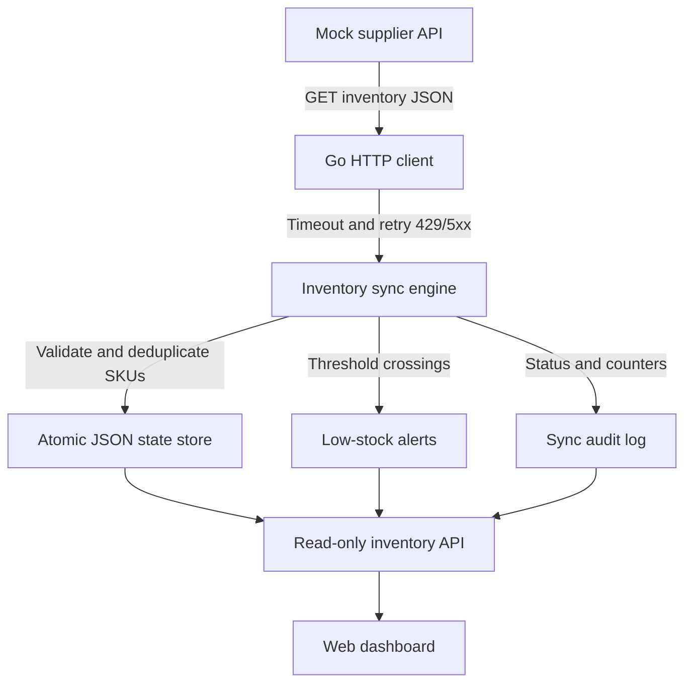

# Inventory Sync Automation Demo

**Go backend integration portfolio project** · REST API · Retry/Timeout · Idempotent SKU Upsert · Low-stock Alerts · Audit Log · Responsive Dashboard

This is a self-contained, runnable demo of an integration problem common to retail and e-commerce businesses: a supplier's inventory API and an internal inventory system have different states. We fetch changes, validate them, update a persisted store, and produce meaningful low-stock alerts.

> All supplier records are fictional. This project does not connect to Shopify, Xilnex, real POS accounts, or any employer-owned system. It uses only the Go standard library and needs no API key or paid cloud service.

## Quick start

Requires **Go 1.22+**.

```bash
go run ./cmd/server
```

Visit **http://127.0.0.1:8080**.

1. Select **Run synchronization**: four supplier products are imported; one low-stock alert fires.
2. Run it again: `unchanged=4`, no duplicate alerts (idempotency).
3. Select **Simulate stock drop**: supplier's `COFFEE-001` quantity becomes 4. Press **Run synchronization** again to see one update and one new alert.
4. Restart the service: synced items, alerts, and run logs remain in `data/inventory-state.json`. Note: mock supplier changes reset on restart because it is intentionally a separate in-memory simulator.

Want to start fresh? Stop the server and delete `data/inventory-state.json`.

## API endpoints

| Method | Path | Purpose |
|---|---|---|
| GET | `/api/health` | Health check |
| POST | `/api/sync` | Fetch and reconcile inventory |
| GET | `/api/items` | Inventory records |
| GET | `/api/alerts` | Most recent 100 low-stock threshold-crossing alerts |
| GET | `/api/runs` | Latest 50 sync runs, including failures |
| GET | `/mock/supplier/items` | Fictional supplier payload |
| PATCH | `/mock/supplier/items/{sku}` | Change a mock supplier item's quantity |
| POST | `/mock/supplier/fail-next` | Force 0–5 upcoming supplier requests to return 503 |

Example command-line session:

```bash
curl -s http://127.0.0.1:8080/api/health
curl -s -X POST http://127.0.0.1:8080/api/sync
curl -s http://127.0.0.1:8080/api/items
curl -s -X PATCH http://127.0.0.1:8080/mock/supplier/items/COFFEE-001 \
  -H 'Content-Type: application/json' -d '{"quantity":4}'
curl -s -X POST http://127.0.0.1:8080/api/sync
```

To test *successful automatic retry* of transient supplier errors (three fetch attempts total):

```bash
curl -s -X POST http://127.0.0.1:8080/mock/supplier/fail-next \
  -H 'Content-Type: application/json' -d '{"count":2}'
curl -s -X POST http://127.0.0.1:8080/api/sync
```

To test a failed run, use `count=3`, then sync. A failure is added to the audit log without changing the items.

## Architecture



**Business rules implemented**
- Supplier SKU uniquely identifies each inventory item.
- Changed products update; unchanged products are not rewritten. Missing products are **not** automatically deleted.
- Low-stock alerts fire only for **new below-threshold items** or when quantity crosses from at/above the threshold to below it; repeated syncs do not spam alerts.
- The source is validated before any inventory changes are committed; malformed or duplicate SKUs fail the whole run.
- Each run is serialized and records success/failure. A snapshot is written with temporary file + atomic rename on the same filesystem.
- A failing network request retries on `429` and `5xx` (max three attempts) with limited backoff; `400` does not retry.

**Operational limitations (intentionally out of scope)**
- Demo-only state is a local JSON file, not MySQL or PostgreSQL. This is not a production database, and atomic rename is not a substitute for a transactional multi-user DB.
- No login/authentication, webhook signature verification, TLS, or rate limiting. **Never expose this demo publicly.** The default process listens only on `127.0.0.1`.
- No scheduler, distributed locks, multi-instance support, real email delivery, or external alert integrations. Alerts are shown in the dashboard only.
- Mock supplier changes are in-memory and reset when the server restarts; stored internal inventory state persists.
- All prices are integer cents to avoid floating-point currency errors.
- A real deployment should add a secured integration endpoint, database migrations, encrypted secrets, source-of-truth policy, monitoring, and customer-specific rules.

## Tests

```bash
go test ./...
go test -race ./...
go vet ./...
```

Tests cover idempotency, crossing detection, persistence, invalid payload isolation, supplier retry policy, and the HTTP integration flow.

## Optional Docker

```bash
docker compose up --build
```

The demo listens on `0.0.0.0` **inside the container only**; Docker publishes it to host `127.0.0.1:8080` only. A named Docker volume stores the persistent demo state. Do not change the host port mapping to `0.0.0.0` without adding authentication. Local native Go is the simplest option.

## Commercial case-study framing

**Client problem:** A retailer manually compares supplier stock and the internal inventory record, causing delayed updates and missed low-stock replenishment.

**Proposed integration:** Pull stock data from an upstream API, validate and upsert product records, record sync outcomes, and alert on threshold crossings.

**What this demo actually proves:** The integration behavior above runs locally with fictional data. It is **not** proof of a real Shopify/Xilnex integration, customer deployment, or a measured percentage reduction in manual work.

**Potential paid service:** A fixed-scope inventory API sync sprint, after checking both systems' API access, rate limits, data mapping, error handling, permissions, and acceptance tests.

## Project structure

```text
cmd/server/main.go              Local demo server
internal/inventory/client.go    Supplier HTTP client and retry logic
internal/inventory/engine.go    Validation, upsert, alerts, audit
internal/inventory/store.go     Persistent JSON snapshot
internal/inventory/mock.go      Fictional supplier API
internal/inventory/http.go      Demo REST API and embedded UI
internal/inventory/web/        Responsive dashboard
internal/inventory/*_test.go    Automated tests
```

## License

MIT. See LICENSE. Before publishing on your own GitHub account, change the example `github.com/example/inventory-sync-demo` module path in `go.mod` and the import in `cmd/server/main.go` to your real repository URL.
